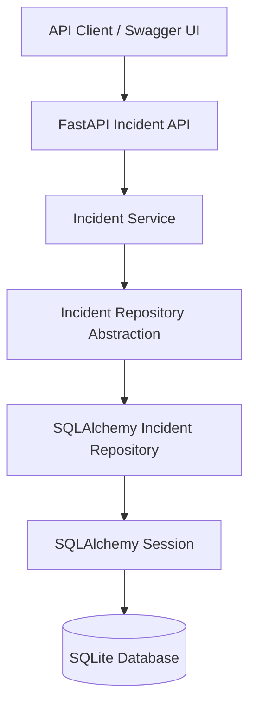
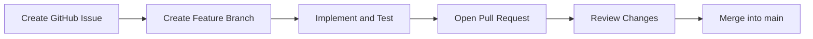

# Enterprise AI Support & Autonomous Incident Resolution Platform

An evidence-first AI-powered IT support platform designed to evolve from incident management into intelligent diagnosis, risk assessment, approved remediation, verification, and reusable troubleshooting knowledge.

This is a production-oriented learning and portfolio project focused on clean architecture, API design, database persistence, automated testing, GitHub engineering workflows, and evidence-driven development.

> **Current status:** FastAPI incident-management API and SQLAlchemy/SQLite persistence are implemented. PostgreSQL migrations, AI-assisted diagnosis, and autonomous remediation are planned milestones, not completed features.

## Project Overview

IT support teams often manually receive incidents, investigate technical problems, collect diagnostic evidence, identify probable causes, assess risk, recommend fixes, verify outcomes, and document resolutions.

This project aims to build a platform that gradually supports this lifecycle through APIs, structured incident data, evidence-based investigation, AI-assisted reasoning, risk controls, and controlled remediation workflows.

Every major capability is developed incrementally, tested, documented, and supported by project evidence.

## Project Goals

The long-term vision is to build a platform capable of:

1. Receiving and managing IT incidents.
2. Classifying and prioritizing incidents.
3. Collecting technical evidence.
4. Identifying probable root causes.
5. Assessing remediation risk.
6. Recommending appropriate remediation.
7. Requesting human approval when required.
8. Executing authorized remediation actions.
9. Verifying remediation results.
10. Documenting incident resolution.
11. Reusing troubleshooting knowledge.

## Implemented Features

### Application foundation
- Python virtual environment and project structure.
- FastAPI application.
- Git and GitHub repository workflow.
- Feature branches, GitHub Issues, and Pull Requests.
- Architecture and learning documentation.

### Incident management API
- Incident domain schemas and priority/status models.
- API request and response validation.
- Incident service layer and repository abstraction.
- Incident creation, listing, and retrieval.
- HTTP 404 handling for missing incidents.
- Interactive Swagger/OpenAPI documentation.

### Database persistence
- SQLAlchemy ORM model for incident records.
- SQLite development database.
- Database connection and session management.
- SQLAlchemy incident repository.
- Incident API integration with database persistence.
- Integration tests for repository/database behavior.
- Database persistence verification evidence.

### Engineering evidence
- Architecture documentation and diagrams.
- GitHub Issue and Pull Request history.
- Swagger and database screenshots.
- Automated test evidence.

## Technology Stack

| Area | Technology |
|---|---|
| Language | Python |
| API framework | FastAPI |
| Data validation | Pydantic |
| ORM | SQLAlchemy |
| Current development database | SQLite |
| Testing | pytest |
| API documentation | OpenAPI / Swagger UI |
| Version control | Git |
| Collaboration workflow | GitHub Issues and Pull Requests |
| Planned database | PostgreSQL |
| Planned migrations | Alembic |

## Current Architecture

The current incident-management flow uses a layered design:



The API layer handles HTTP requests and responses. The service layer separates application logic from transport details. The repository layer handles persistence through SQLAlchemy.

This separation makes it easier to test components and evolve database implementations without coupling all application logic to a specific database.

## Project Structure

```text
enterprise-ai-support-automation-platform/
├── backend/
│   ├── app/
│   │   ├── api/
│   │   │   └── v1/
│   │   │       └── incidents.py
│   │   ├── database/
│   │   │   └── connection.py
│   │   ├── models/
│   │   │   └── incident.py
│   │   ├── repositories/
│   │   │   └── sqlalchemy_incident_repository.py
│   │   ├── services/
│   │   └── main.py
│   └── tests/
│       └── test_sqlalchemy_incident_repository.py
├── docs/
│   ├── architecture/
│   ├── features/
│   ├── learning-notes/
│   └── screenshots/
├── .env.example
├── .gitignore
├── README.md
└── requirements.txt
```

This is a representative view of the main files and directories; the repository may contain additional files.

## Getting Started

### Prerequisites
- Python installed.
- Git installed.
- PowerShell on Windows, or a compatible terminal on another operating system.

### 1. Clone the repository

```powershell
git clone https://github.com/YogeshS-Mca/enterprise-ai-support-automation-platform.git
cd enterprise-ai-support-automation-platform
```

### 2. Create a virtual environment

```powershell
python -m venv .venv
```

Activate it in Windows PowerShell:

```powershell
.\.venv\Scripts\Activate.ps1
```

### 3. Install dependencies

```powershell
python -m pip install --upgrade pip
pip install -r requirements.txt
```

### 4. Run the API

From the repository root:

```powershell
python -m uvicorn backend.app.main:app --reload
```

While the server is running, open:

- Swagger UI: `http://127.0.0.1:8000/docs`
- OpenAPI schema: `http://127.0.0.1:8000/openapi.json`

Use Swagger UI to inspect the actual registered endpoints and test the API.

> The current development database uses SQLite. PostgreSQL configuration will be documented as part of the planned PostgreSQL/Alembic milestone.

## Running Tests

From the repository root, with the virtual environment activated:

```powershell
python -m pytest -v
```

Automated tests help verify incident repository behavior and protect existing functionality as new features are introduced.

## Database Design

The current database implementation uses SQLAlchemy with SQLite.

Incident records include fields for the incident identifier, title, description, priority, status, and timestamps, as defined by the current ORM model.

The SQLAlchemy repository handles database operations through a managed session. The API uses this repository to persist and retrieve incidents.

### Planned database improvements

- Environment-based database URL configuration.
- PostgreSQL connectivity.
- Alembic migration configuration.
- Version-controlled schema migrations.
- Migration upgrade and verification tests.
- Safe configuration of credentials and environment variables.

The planned migration workflow will use Alembic to manage schema changes explicitly instead of relying on `Base.metadata.create_all()` as the production schema-management mechanism.

## GitHub Development Workflow

The project uses a feature-branch workflow:



Start new work from the latest `main`:

```powershell
git switch main
git pull origin main
git switch -c feature/your-feature-name
```

After implementing and testing a feature:

```powershell
git add .
git commit -m "feat: describe the implemented feature"
git push -u origin feature/your-feature-name
```

Open a Pull Request on GitHub, review the diff, verify the checks, and merge after the changes are ready.

Use descriptive commit messages and keep unrelated documentation and implementation changes in separate branches.

## Documentation and Screenshots

The `docs/` directory contains architecture notes, feature documentation, learning notes, and implementation screenshots.

The screenshots provide evidence of real milestones, such as API execution, database persistence, architecture design, and GitHub workflow activity.

## Roadmap

- [x] Initialize the FastAPI project.
- [x] Establish the incident-management API foundation.
- [x] Add request validation and API documentation.
- [x] Introduce the service and repository layers.
- [x] Add SQLAlchemy persistence using SQLite.
- [x] Connect the incident API to the SQLAlchemy repository.
- [x] Add persistence integration tests and evidence.
- [ ] Add PostgreSQL configuration through environment variables.
- [ ] Introduce Alembic schema migrations.
- [ ] Improve API error handling and test coverage.
- [ ] Add authentication and role-based access control.
- [ ] Implement AI-assisted incident classification and troubleshooting.
- [ ] Design risk-aware remediation with approval and audit trails.
- [ ] Add remediation outcome verification.
- [ ] Develop reusable troubleshooting knowledge.
- [ ] Add production-oriented deployment, monitoring, and security practices.

## Learning Objectives

This project demonstrates practical learning in:

- Building REST APIs with FastAPI.
- Validating API data with Pydantic.
- Applying layered architecture and repository abstractions.
- Managing persistence with SQLAlchemy.
- Testing database-backed application behavior.
- Planning database schema migrations.
- Using Git branches, commits, Issues, and Pull Requests.
- Documenting architecture and technical decisions.
- Evolving an AI-support application with appropriate safety and approval controls.

## Security Notes

- Never commit real passwords, API keys, tokens, or private environment files.
- Keep `.env.example` limited to placeholder values.
- Use appropriate access controls for production deployments.
- Require authorization and appropriate safeguards before executing consequential remediation actions.

## Project Status and License

This is an active learning and portfolio project. Features listed under the roadmap are planned and should not be interpreted as implemented.

No license has been specified yet. Add a `LICENSE` file if you decide to publish the project under an open-source license.
